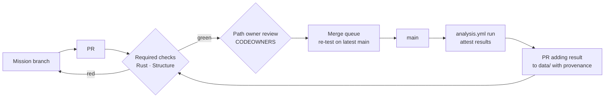

# Founding council — Round 2 brief (Rust / platform)

Position of A10 (Rust Manager) on organisation: what the platform side must build first, how analysis code gets the same protection as the rest of the code, and how Platform should be organised and measured.

**Short answer.** Build the least that lets Mission 2 and the first Mendelian randomisation (MR) analysis ship in six weeks. That means the PR + merge queue flow that is being switched on, an `analyses/` area where each analysis is a Rust crate under the existing lints and seal, a small statistics crate `astra-stats` whose estimators are tested against numbers printed in published papers and package documentation, and one analysis workflow with attestation. Sharding, encryption, GitHub Apps, OpenTimestamps (OTS) and most estimators wait until a stated trigger fires. Platform is a shared service: it owns the rails (tooling, CI, schemas, site, statistics library), and research divisions own what runs on them. Platform is measured on CI time, red-main time, queue wait and rerun success, not on features shipped.

Binding rule (president, council G60): all project code is Rust. This brief follows it everywhere.

---

## 0. Where we start

| Item | State today |
|---|---|
| Required CI checks | 2 jobs: `Rust (lints · tests)` and `Structure (lengths · folders · chain)` (`.github/workflows/ci.yml`) |
| Seal | `protected-files.yaml` lists the lint config, check scripts, `ci.yml`, callbacks and `chain.sh`; changing any of them needs the president's password |
| Structure rule | ≤ 500 lines per file, ≤ 8 entries per folder, Rust and web trees only |
| Lint exceptions | Registry `allowed-lint-exceptions.yaml`, currently empty |
| Merge path | Being switched to PR required + `enforce_admins: true` + merge queue (`docs/rust/pr-workflow.md`) |
| Statistics code | None. Crates today: `astra-db`, `astra-site`, `astra-cli` |
| `analyses/` | Does not exist yet |
| Decisions | `docs/decisions/0001`–`0003`; decisions are never rewritten, only superseded |

---

## 1. Challenge 1: minimal pipeline first, no cathedral

The aim: by week 6, Mission 2 has merged `data/metrics/` and a scoring rule v0, and one drug-target MR analysis has run in CI from a pinned snapshot, with an attested result that a reviewer can rerun.

### 1.1 Week by week

| Week | Built | Done when |
|---|---|---|
| **1** | PR flow live: `enforce_admins: true`, PR required, merge queue on, `merge_group` trigger in `ci.yml` (already prepared). `Agent: A<n>` commit trailer, checked in CI (warning only). | A test PR goes branch → queue → `main`; a direct push is refused. |
| **2** | A9 + A28: schema for `data/metrics/` (one YAML per metric: name, definition, unit, direction, source DOI, validation status). `astra db build` validates it. Scoring rule v0 as a versioned YAML + Rust function with unit tests. | `astra db build --check` fails on a bad metric file; scoring rule tests green. |
| **3** | `analyses/` skeleton: `analyses/<id>-<slug>/` is a binary crate in the workspace (`analysis.yaml`, `Cargo.toml`, `src/`, `tests/`). `crates/astra-stats` seed: inverse-variance weighted (IVW), MR-Egger and weighted-median MR estimators, each with reference-number tests (§2.3). No new CI job: the existing `Rust` and `Structure` checks cover it. | A dummy analysis builds under full lints; the three estimators match their reference values within the stated tolerance. |
| **4** | `astra db export --canonical` (sorted objects, one serialisation, SHA-256). Workflow `analysis.yml`: checkout pinned commit, verify snapshot hash, download inputs listed in a fetch manifest and check their SHA-256, run the analysis binary, upload `results.yaml`, `actions/attest`. Manual trigger only. | Same inputs give the same `results.yaml` digest twice in a row. |
| **5** | First MR analysis (A28 content) runs through it. Either `astra-stats` has colocalisation (coloc ABF, ~1 week, can start in week 4 in parallel) or the result is explicitly labelled **"single-region, no colocalisation, capped at L1"**. Provenance fields (`analysis`, `run_id`, `snapshot_hash`, `artifact_digest`, `attestation`) added to the schema; `check-provenance.sh` refuses a computed value without them. | The MR result is in `data/` with a verifiable attestation (`gh attestation verify`) and its label. |
| **6** | Stabilise: path filters (Rust build only when `crates/`, `analyses/`, `Cargo.*` or lint config change), CI time budget checks, `ledger/` add-only check (`check-ledger.sh`) so predictions from the MR result can be logged. | p50 CI for a data-only PR < 3 min; the ledger refuses an edit to an existing entry. |

About 5 Rust/CI weeks for A10's workers (pipeline ~3, statistics ~2), plus A9 schema work in weeks 2 and 5. Nothing here needs money or a president action beyond the seal re-approvals (§3.6).

### 1.2 What explicitly waits, and what brings it in

| Deferred | Why it can wait | Trigger that brings it in |
|---|---|---|
| Hash sharding of `data/` | 1,224 files today; the GitHub UI truncates at 1,000 entries per folder | Any `data/` folder passes **700** files (structure check warns at 700) |
| ULID identifiers | Few writers create objects at the same time today | First ID collision in the merge queue, or > 20 agents writing `data/` in the same week |
| Append-only verification logs | No scheduled re-checking yet | First re-check campaign is planned |
| Results encrypted in CI (blinding) | No blinded replication is scheduled before month 3 | A28 schedules the first blinded replication |
| GitHub Apps (bot identities) | Results enter `data/` through PRs opened by agents, with attestation | The analysis workflow must open PRs itself, or bots need rights separate from agents |
| OpenTimestamps second anchor | Rekor (via `actions/attest`) already timestamps ledger entries | First ledger prediction with a stake outside Astra (external forecast, preregistration) |
| Nightly re-run sampler | Fewer than 10 analyses | 10 merged analyses |
| 10^5 synthetic scale test | Builds take 0.03 s | `data/` passes 10^4 files, or `astra-db` build logic changes |
| Random-effects meta-analysis (DL, REML, Hartung-Knapp) | Mission 2 and the first MR need none | First living meta-analysis mission (A2/A28) |
| MR Steiger directionality, MR robustness extras | IVW/Egger/WM cover the first analysis | Second MR analysis, or a reviewer asks for direction testing |
| Survival (Kaplan-Meier, Cox PH) | No individual-level time-to-event data yet | First analysis on a public cohort with time-to-event data |
| Brier score + base-rate baseline | No prediction has resolved yet | First ledger resolution is due |
| Paid or self-hosted runners | 20 free concurrent jobs is far above need | Queue wait p90 > 15 min for a week |

Rule: a deferred item enters only with a decision record that names the trigger it met.

---

## 2. Rust scientific-computing stack: plan and gaps

### 2.1 Existing crates, per need

Figures from the crates.io API on 2026-10-19 (latest release, all-time downloads, last-90-day downloads). Owners = accounts with publish rights, from `/api/v1/crates/<name>/owners` the same day (not the same as active maintainers).

| Need | Crate | Latest | Downloads (all / 90 d) | Owners | Verdict |
|---|---|---|---|---|---|
| Dataframes | [polars](https://crates.io/crates/polars) | 0.55.2, 2026-08-06 | 15.9 M / 2.8 M | 2 | Use only if needed: still pre-1.0, API changes often, heavy compile. Pin exactly |
| Columnar IO | [arrow](https://crates.io/crates/arrow), [parquet](https://crates.io/crates/parquet) | 60.0.0, 2026-10-15 | 89 M / 23 M; 85 M / 21 M | 8; 9 | Use to read large external inputs (GWAS summary files in Parquet) |
| Text tables | [csv](https://crates.io/crates/csv) | 1.4.0, 2025-10-17 | 269 M / 57 M | 1 | Default for TSV/CSV inputs; stable 1.x |
| Compression | [flate2](https://crates.io/crates/flate2) | 1.1.10, 2026-08-28 | 763 M / 188 M | 3 (incl. `rust-lang-owner`) | `.gz` summary statistics |
| Arrays | [ndarray](https://crates.io/crates/ndarray) | 0.17.2, 2026-01-10 | 134 M / 31 M | 3 | Default n-dimensional arrays |
| Linear algebra | [nalgebra](https://crates.io/crates/nalgebra) | 0.35.0, 2026-05-24 | 96 M / 16.7 M | 2 | Small dense systems (regressions with few covariates) |
| Linear algebra (large) | [faer](https://crates.io/crates/faer) | 0.24.4, 2026-06-24 | 5.2 M / 1.5 M | 1 | Only for large matrices (Cox with many covariates, LD matrices); younger, smaller user base |
| Distributions, tests | [statrs](https://crates.io/crates/statrs) | 0.19.1, 2026-08-11 | 43 M / 11 M | 1 + team `statrs-dev` | Normal, t, chi-squared CDFs and quantiles for p-values and intervals |
| Optimisation | [argmin](https://crates.io/crates/argmin) | 0.11.0, 2025-09-28 | 5.4 M / 1.7 M | 1 | REML and Cox partial likelihood; newest release a year old, watch it |
| HTTP fetch (manifests) | [ureq](https://crates.io/crates/ureq) | 3.4.2, 2026-09-13 | 233 M / 71 M | 2 (reqwest: 1) | Preferred: blocking, small. [reqwest](https://crates.io/crates/reqwest) 0.13.5 (814 M) if async is ever needed |
| Hashing | [sha2](https://crates.io/crates/sha2) | 0.11.1, 2026-10-12 | 1,081 M / 311 M | 2 + team `rustcrypto` | SHA-256 of inputs and snapshots |

Every new dependency is a PR reviewed by A10. The workspace pins versions in `Cargo.lock`, which is already committed.

### 2.2 Gaps we write ourselves: `crates/astra-stats`

No mature Rust crate covers these. They are short, well-documented formulas; the risk is subtle errors, which §2.3 addresses.

| Estimator | Contents | Effort (one worker) |
|---|---|---|
| MR core | IVW (fixed and multiplicative random effects), MR-Egger (slope, intercept), weighted median with bootstrap standard error | ~1 week |
| MR Steiger | Direction test from variance explained | ~2 days |
| Colocalisation | coloc approximate Bayes factors (ABF), posterior probabilities H0–H4 | ~1 week |
| Random-effects meta-analysis | DerSimonian-Laird, REML (via argmin), Hartung-Knapp adjustment, τ², I², Q test | ~1.5 weeks |
| Survival | Kaplan-Meier with Greenwood variance; Cox proportional hazards (Breslow/Efron ties) | ~2–3 weeks (Cox is the hard part) |
| Forecast scoring | Brier score, base-rate baseline, Brier skill score | ~2 days |

Total ~7–8 worker-weeks, spread over the triggers in §1.2; only MR core (and coloc if possible) is in the six-week plan. Each estimator is a module ≤ 500 lines; the crate uses folders ≤ 8 entries like the rest of `crates/`.

### 2.3 Validation rule: positive controls against published numbers

- Every estimator ships with **positive-control tests** that run it on a published dataset and compare to numbers **printed** in a paper or in package documentation. The test file cites the source URL or DOI and states the tolerance (default: agree to the last printed digit, i.e. ±0.5 in that digit).
- Example, printed values checked on 2026-10-19: Normand (1999), *Statistics in Medicine* 18(3):321–359, stroke-unit dataset (9 studies, mean difference in length of stay, homoscedastic variances), Table X, reproduced by metafor ([metafor-project.org, Normand 1999](https://www.metafor-project.org/doku.php/analyses:normand1999)). Equal-effects: estimate −3.49, SE 0.78, 95 % CI −5.03 to −1.96, Q(8) = 241.06, I² 96.68 %. DerSimonian-Laird: τ² 218.72, estimate −14.10, SE 5.28, CI −24.45 to −3.75. REML: τ² 685.20 (SE 360.37), I² 98.92 %, estimate −15.12, SE 8.95, CI −32.67 to 2.43. The input table (n, mean, SD per arm) is printed on the same page, so the test needs no R. A Hartung-Knapp reference case is still to be chosen by Verification before that adjustment is merged.
- MR and coloc references: **reference case to be selected by Verification** before each estimator is merged. Only printed outputs on fixed inputs count; simulated vignette outputs that change between runs are not usable.
- **We never run R or Python to produce references**, not even locally. If no printed number exists, the estimator is not merged, or is merged behind a "not validated" flag that blocks its use in `data/`.
- Re-validation after any change to `astra-stats` or a dependency bump is a **Verification** task: Verification owns the list of reference cases and tolerances; Platform owns the code.

### 2.4 `analyses/` as Rust crates

- `analyses/<id>-<slug>/` is a binary crate and a workspace member: same `[workspace.lints]`, same `clippy.toml`, same toolchain, same seal. Nothing new to protect: the existing gates already cover it once `analyses/*` joins the workspace members and `check-structure.sh` scans `analyses/` (≤ 500 lines per file, ≤ 8 entries per folder inside each analysis; not on `analyses/` itself, which grows one folder per analysis and follows the 700/1,000 data rule).
- Each analysis depends on `astra-stats` and on crates from §2.1 only; an extra dependency needs A10 review.
- Determinism: seeds in `analysis.yaml`, no network after the fetch step, no wall-clock in outputs.
- Content (question, code, tests) is owned by the division; `astra-stats` and the shared config are owned by Platform (§3.2).

### 2.5 Exceptions

One registry, unchanged: `.github/checks/allowed-lint-exceptions.yaml` (sealed). Any `#[allow]` / `#[expect]` in `analyses/` or `astra-stats` needs an entry with reason and strategy, like everywhere else. Numerical code will tempt `clippy::float_cmp` and cast lints; the expected answer is a helper (`approx_eq` with stated tolerance, checked casts), not an exception.

---

## 3. Organisation (R2): Platform as a shared service

### 3.1 Refining the strawman

The chair's matrix (methods × programmes + independent Verification + Platform + Strategy) works for me, with three changes on the platform side:

1. **Platform is a service, not a division that decides science.** Units: Code & CI (A10), Statistics library (`astra-stats`, under A10), Data & schemas (A9), Interface (A11), Coherence & repo structure (A7). It never chooses what to analyse; it decides how anything gets into `main`.
2. **Verification must not share CI admin rights with the teams it verifies.** Verification owns the replication workflows' *content* (what to rerun, reference cases, tolerances), Platform owns the runner and the code. Neither can change the other's files without the other's review.
3. **One owner per path, always.** Matrix structures fail when two managers own the same folder. `OWNERS.md` keeps "one path → one manager"; the matrix lives in missions, not in folders.

### 3.2 Who owns what in analyses

| Part | Owner | Why |
|---|---|---|
| Workspace lints, toolchain, `check-*.sh`, `analysis.yml`, `check-provenance.sh` | A10 (sealed) | Rails |
| `crates/astra-stats` code | A10 (Platform statistics unit) | Shared library, one implementation per estimator |
| Reference cases + tolerances for `astra-stats` | Verification (→ A1) | Independence |
| `analysis.yaml` schema, provenance fields, `data/metrics/` schema | A9 | Data contracts |
| `analyses/<id>-<slug>/` content | The mission's division (A28 Research by default; A2 for evidence syntheses) | Science |
| Re-run sampler policy | Verification (→ A1) | Independence |

In `OWNERS.md`: `analyses/` → owning manager named in each `analysis.yaml` (`owner: A28`); CI checks the PR's `Agent:` trailer against that field.

### 3.3 How a mission's output reaches `main`

Two gates matter. **Machine gates:** the required checks, re-run by the merge queue on top of the latest `main`. **Owner gate:** one review from the path owner (CODEOWNERS). Today PRs need 0 approvals, because all agents share one GitHub account and GitHub does not count a self-review. A real owner gate needs separate identities (GitHub Apps or a non-admin token per role). Until then the owner gate is a convention checked from the `Agent:` trailer, and I say so plainly.

### 3.4 Path ownership at thousands of agents

- **CODEOWNERS stays coarse:** one line per top-level area or per division folder, never per agent. GitHub ignores a CODEOWNERS file over 3 MB and then requests no reviewers ([GitHub docs](https://docs.github.com/en/repositories/managing-your-repositorys-settings-and-features/customizing-your-repository/about-code-owners)). Coarse lines keep it tiny.
- **Fine ownership lives in the data:** `owner:` in `analysis.yaml`, `mission:` in data files. CI checks them; GitHub doesn't need to know.
- **Nested owners like Kubernetes:** a division may add an `OWNERS.md` in its folder that lists sub-owners, and the closest file wins (§4).

### 3.5 Span of control, depth and Platform staffing

- **Manager → workers: ≤ 8 active workers per manager.** The same number as our folder rule, for the same reason: above it, the manager stops reading what each one does. Today A10 runs 1–3.
- **Depth ≤ 3 below the president** (president → A1 → manager → worker). If a manager needs more than 8 workers, split the area into two managers (Linux splits subsystems the same way, §4) rather than adding a layer.
- **Statistics is a real Platform unit**, not a side job: ~7–8 worker-weeks to cover §2.2, then steady maintenance (dependency bumps, new estimators on trigger, re-validation support). Staffing: 1–2 workers under A10 from week 3; if `astra-stats` passes ~10 estimators or A10 passes 8 workers, it gets its own manager.
- **Pipeline staffing grows with merges, not with agents:** one Platform worker per ~200 merged PRs/week as a starting rule, to be checked against our own numbers after month 3.

### 3.6 Governing tooling changes

| Change | Process |
|---|---|
| New required check, new tool, or change to a gate (e.g. raise the line limit) | Decision record `docs/decisions/NNNN-*.md` (context, decision, consequences, **trigger met**). Every manager may object for one working day. A1 rules. Then the president re-seals. |
| Lint exception added | Entry in the registry with reason + strategy; A10 review; president re-seals. |
| Toolchain bump, new dependency | Ordinary PR by A10; must pass all checks on the whole repo, including every `astra-stats` reference test; seal update if the toolchain file changes. |
| New estimator in `astra-stats` | PR with its reference tests; Verification approves the reference cases. |
| Workflow that writes to `main` or uses secrets | Decision record + president approval (it can leak secrets). |

The seal is the brake: no agent, A10 included, can loosen a gate without the president typing the password. That is slow on purpose, so batch seal changes into one session a week.

### 3.7 Service levels and how Platform is measured

| Measure | Target (month 1–3) | Why |
|---|---|---|
| CI time, data-only PR (p50 / p90) | < 3 min / < 6 min | Path filters + cached binary |
| CI time, Rust PR (p50) | < 12 min | Release build + tests, `astra-stats` included |
| Merge-queue wait (p90) | < 15 min | Above this, buy capacity (§1.2) |
| Red `main` | 0 hours per week; any red `main` reverted within 1 hour | The queue should make it impossible |
| `astra db build --check` | < 1 s now; < 60 s at 10^6 records | R1 budget |
| Site build | < 2 min | Pages deploy on each merge |
| `astra-stats` reference tests | 100 % pass on `main` | Validation rule §2.3 |
| Analysis reproducibility | 100 % of sampled reruns within tolerance | The reason the rails exist |
| Seal changes | ≤ 1 session per week | President time |

These numbers are read from the Actions API and the git log, and published by a script into `docs/rust/platform-report.md` each week (generated in CI, never typed in). Platform is judged on these and on missions shipped on time, not on how much tooling it builds.

### 3.8 What A2's and A28's R2 proposals ask of Platform

| Their proposal | Platform work | When |
|---|---|---|
| PICO question registry (population, intervention, comparator, outcome) to avoid duplicate reviews | Schema (A9) + CI overlap check: a new question whose PICO matches an open one fails with a link to it | With the first meta-analysis mission |
| Protocols sealed by Verification before data access | Protocol file committed and attested (Rekor) before the analysis PR; `check-provenance.sh` refuses a result whose analysis has no earlier sealed protocol | Week 5 (MR protocol), as a convention; enforced by CI from month 2 |
| Ledger typed T1–T6 | `type:` field in each ledger entry, checked against the list; add-only check as in week 6 | Week 6 |
| Verification ≥ 40 % of research capacity | Reruns roughly double analysis CI load: size the queue and runner budget for 1.4–2× analysis jobs; heavy reruns in a separate `concurrency:` group so they never starve the merge queue | From the first rerun |

---

## 4. Benchmarks: how large open projects run their platform

| Project | Structure | What we take |
|---|---|---|
| **Linux kernel** | A `MAINTAINERS` file maps every path to subsystem maintainers, who must be people, not mailing lists. One `Acked-by` / `Reviewed-by` from a maintainer is enough for a patch. Maintainers send signed pull requests up a tree of maintainers to Linus ([maintainers](https://docs.kernel.org/process/maintainers.html), [feature and driver maintainers](https://docs.kernel.org/maintainer/feature-and-driver-maintainers.html), [pull requests](https://docs.kernel.org/maintainer/pull-requests.html)). | Path → named owner (our `OWNERS.md`). Split areas instead of adding layers. Subsystems may set their own review time limits: our service levels. |
| **Rust project** | Teams own areas (compiler, language, libs, infrastructure). Every major change starts as an RFC, gets team labels, triage and a final comment period; a Leadership Council of top-level team representatives handles work across teams ([governance](https://rust-lang.org/governance/), [rust-lang/rfcs](https://github.com/rust-lang/rfcs)). | Decision records with a fixed comment period before a ruling. Infrastructure is its own team that serves the others. |
| **Kubernetes** | Special Interest Groups (SIGs) own areas. `OWNERS` files list reviewers and approvers per folder; a sub-folder's file overrides its parent. A PR needs `/lgtm` from a reviewer and `/approve` from an approver, then a bot merges it ([participate](https://kubernetes.io/docs/contribute/participate/), [SIGs](https://www.kubernetes.dev/community/community-groups/sigs/)). | Nested owner files; review vs approve split; bot-driven merge, like our merge queue. |
| **Wikipedia bots** | Every bot needs approval by the Bot Approvals Group: a request, a limited trial run, then approval and a bot flag. Bots running outside their approval are blocked by admins ([bot policy](https://en.wikipedia.org/wiki/Wikipedia:Bot_policy), [requests for approval](https://en.wikipedia.org/wiki/Wikipedia:Bots/Requests_for_approval)). | Closest to us: many automated writers on a shared text base. New agent roles that write `data/` at scale go through a **trial PR** of limited size before they get standing permission. |

Common pattern: ownership is written in files next to the code, approval is per path, and automated writers get a narrow, revocable permission. All four keep the gate mechanical and the judgement human (here: managers and A1).

---

## Minutes

- **Proposed:** six-week minimal pipeline: PR + merge queue (week 1), metrics schema + scoring rule v0 (2), `analyses/` as Rust crates + `astra-stats` seed with IVW/Egger/weighted median (3), canonical snapshot + attested `analysis.yml` (4), first MR analysis with provenance, with coloc or labelled "single-region, capped L1" (5), path filters + typed add-only ledger (6). Everything else, including meta-analysis, survival, Steiger and Brier, waits for a named trigger. All code Rust: existing crates for IO, arrays, distributions, optimisation, fetch and hashing; our own `astra-stats` (~7–8 worker-weeks total), every estimator tested against printed published numbers only (§2.3). No new gate needed: analyses join the workspace lints, seal and structure rule; one exception registry. Platform = shared service (A10 incl. statistics unit, A9, A11, A7); ≤ 8 workers per manager, depth ≤ 3; tooling changes via decision records + seal; measured on CI time, queue wait, red `main`, reference-test and rerun success.
- **Challenged:** writing our own estimators is the main correctness risk of the Rust-only rule; printed reference values limit it but do not cover edge cases. polars is pre-1.0 and argmin is slow-moving, so both are pinned and optional. A real owner review gate is not possible while all agents share one GitHub account. Weekly seal sessions make tooling changes slow on purpose.
- **Open:** printed reference examples for MR and coloc (Verification + A28); A1 approval of the "deferred until trigger" list; whether the first MR waits for coloc or ships capped at L1 (A28); A9 schema for `data/metrics/`, provenance, PICO registry and ledger types; non-admin token / GitHub Apps per role (president); staffing 1–2 statistics workers under A10 from week 3.
